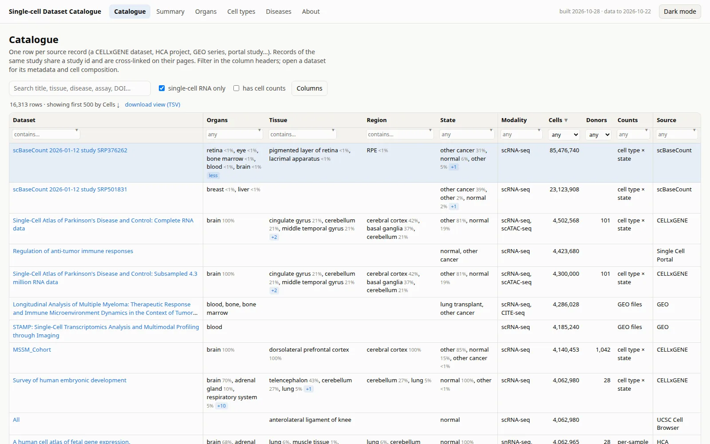
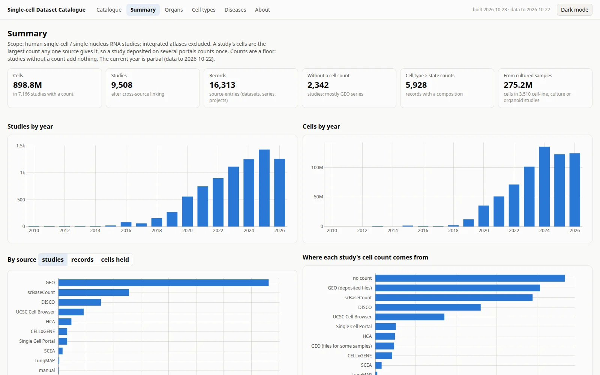
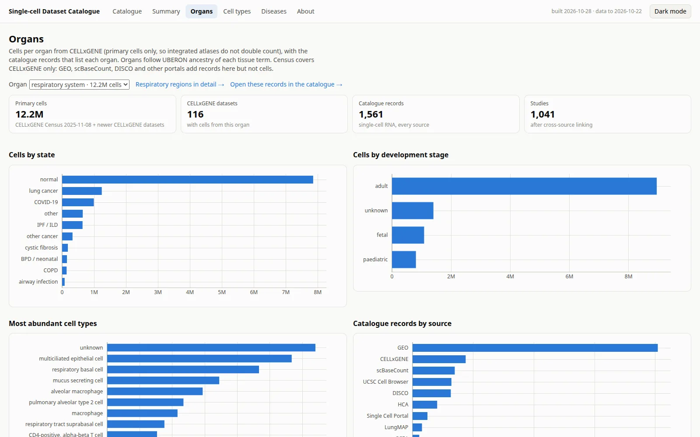
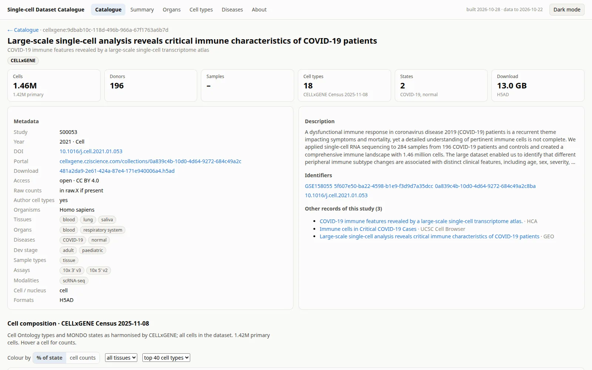
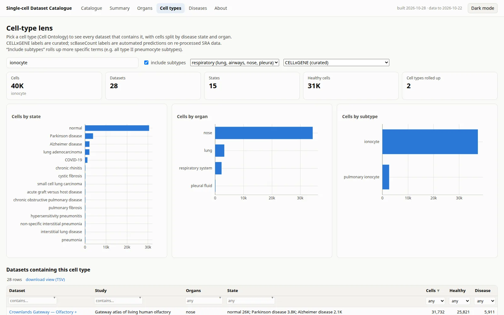
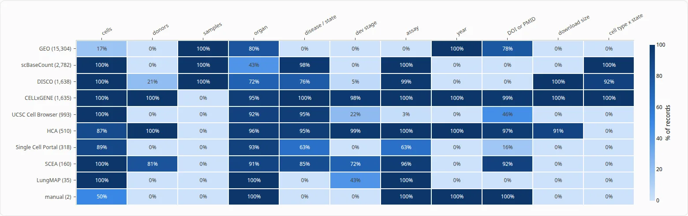

# Single-cell Dataset Catalogue

**Browse it: [thirtysix.github.io/single-cell-dataset-catalog](https://thirtysix.github.io/single-cell-dataset-catalog/)**

A searchable catalogue of public single-cell and single-nucleus RNA-seq datasets, linked across nine
portals and archives, for finding data when planning research: what exists for a tissue, disease or cell
type, how many cells and donors it has, and where to download it.

## At a glance

Build 2026-10-28, source snapshots to 2026-10-22. Human datasets so far.

| | |
|---|---|
| Studies (records linked across portals) | **9,508** from 16,313 records |
| Cells, each study counted once | **898.8M** in 7,166 studies with a count |
| Records with a cell type × state composition | **5,928** |
| Cells from cultured samples (cell lines, organoids) | 275.2M in 3,510 studies |
| Organs with primary CELLxGENE cells | 40; most cells: brain (41.5M), blood (34.7M), respiratory system (12.2M), kidney (4.3M), retina (4.3M), large intestine (4.2M), breast (4.0M), heart (3.8M) |

| Source | Records | Studies | Cells held |
|---|---:|---:|---:|
| GEO | 8,277 | 7,626 | 185.5M |
| scBaseCount | 2,782 | 2,558 | 289.3M |
| DISCO | 1,638 | 1,537 | 135.0M |
| UCSC Cell Browser | 993 | 912 | 99.3M |
| Human Cell Atlas | 477 | 468 | 59.4M |
| CELLxGENE | 1,635 | 315 | 196.0M |
| Single Cell Portal | 318 | 314 | 56.0M |
| Single Cell Expression Atlas | 160 | 147 | 8.5M |
| LungMAP | 31 | 29 | 3.2M |
| manual | 2 | 2 | 1.1M |

"Cells held" counts a study once per source, so a study on two portals appears in both rows; the totals
above count it once. Cell counts are a floor: studies without a count add nothing. CELLxGENE Census
2025-11-08 is the last Census release, so 541 newer CELLxGENE datasets are
counted from their own cell metadata. GEO counts come from the files submitters deposited. The site's
About page says where every number comes from.

## Screenshots

**Catalogue**: every record, filterable by column; list cells are ordered by share of cells, and +N expands them

**Summary**: cells and studies counted once per study, by year, source and category

**Organs**: cells per organ by state, development stage, cell type and assay

**Dataset page**: metadata, linked records and the cell type × state composition

**Cell types**: one Cell Ontology type across every dataset that has it

**Metadata completeness**: what each source records

## About this repository

This repository holds only the generated static site (no build step); each release replaces the previous
one, so there is no history to dig through. Open `index.html` through any static web server to run it
locally, e.g. `python -m http.server` in a clone.

## Licence

The code (`index.html`, `css/`, `js/`) is under the MIT licence. The catalogue data (`data/`), this README
and the screenshots are under [CC BY 4.0](https://creativecommons.org/licenses/by/4.0/). The records
describe datasets held by the source portals and archives, which keep their own terms. Bundled Plotly.js is
MIT, © Plotly, Inc. Full text: [LICENSE](LICENSE).
